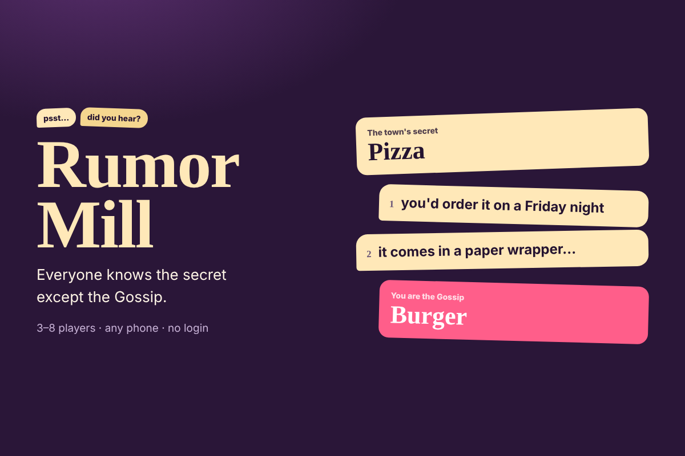

# Rumor Mill

**A whispering game for friends: everyone knows the secret except the Gossip.**



Join a room from any phone with a 4-letter code (no login, no install). Each round, everyone learns the town's secret word, except one secret **Gossip**, who's told a close-but-wrong rumor. Every player privately whispers one hint to one other person, and the recipient sees who sent it. Then every whisper is read to the whole town with no names. Debate, accuse, and catch the Gossip. A caught Gossip gets one last chance: guess the real secret to steal points.

3–8 players · about 10 minutes · same room or on a call.

## How to play

1. **Get your word.** Villagers see the secret; the Gossip sees the rumor.
2. **Whisper.** Send one hint to one person. You can't say your word outright.
3. **Hear the rumors.** Whispers are revealed one at a time, anonymously, on every screen at once.
4. **Accuse.** Debate, then vote at the same time. A tie lets the Gossip escape.

**Scoring:** +2 for each player who accuses the Gossip; the Gossip gets +4 for escaping, or +3 for guessing the real secret after being caught. Three rounds, a new Gossip each time.

The twist: whispers are private but the reveal is public, so whoever received a suspicious whisper knows exactly who sent it.

## How it works

A static site with no backend. The host's browser runs the game and sends each player only what they may see (their own word, their own inbox, anonymous reveals); players connect peer-to-peer with [PeerJS](https://peerjs.com). Refreshing players rejoin their seat; a refreshing host reopens the same room.

```
js/engine.js   rules, roles, whispers, voting, scoring (pure, tested)
js/app.js      screens, host loop, client connection
js/net.js      PeerJS networking with heartbeats and retries
tests/         engine tests and a 3-tab end-to-end game
```

## Run, test, deploy

```bash
python3 -m http.server 5175      # open http://localhost:5175
npm test                          # engine tests
node tests/e2e.mjs                # 3-tab game (needs Playwright)
```

Netlify: import the repo, empty build command, publish `.` (set in `netlify.toml`).
